# Google Play listing skills

Three agent skills for an Android app's **Google Play listing**:

| Skill | Makes |
|---|---|
| **playstore-screenshots** | Phone, tablet and Chromebook screenshots and the feature graphic, from your app's real screens, in every listing language |
| **playstore-description** | App title, short and full description, written for Play search (ASO), plus the listing checklist |
| **playstore-release-notes** | The "What's new" text for each update, from your git history |

They work with Claude Code and other agents that read `SKILL.md` skills. They run on
Windows, macOS and Linux. The only thing they need is Python, plus Pillow for the screenshots.

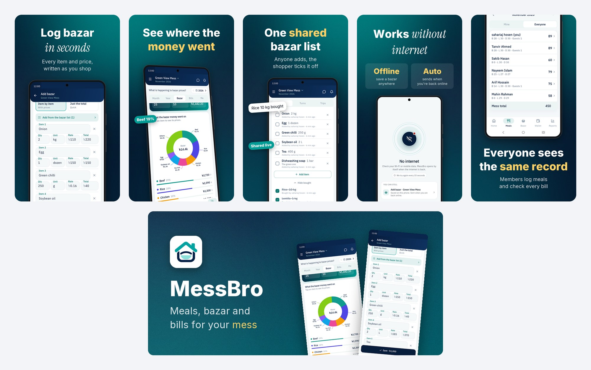

*A real run on [MessBro](https://messbro.vercel.app), a mess-management app: five screenshots in
the `mesh` style with mixed layouts and a panorama background, and the `cards` feature graphic.
The screens use demo data that the skill suggested and added to a separate demo mess. More
examples are in the [gallery](#gallery).*

## Screenshots: what it does

1. **Finds your app's benefits.** It reads your code and writes 4–8 short headlines
   ("SPLIT BAZAR COSTS", not "EXPENSE MODULE"). You approve them. Mark the key words and the
   headline reads in two colours: `*word*` uses the highlight colour, `_word_` uses an accent
   font such as an italic serif.
2. **Suggests demo data.** Empty screens look bad, so it suggests realistic data for each screen.
   If you say yes, it adds that data to a separate demo account, and it notes how to remove it later.
3. **Gets clean screenshots**, in one of two ways:
   - **From your phone or emulator (adb):** it turns on demo mode for a clean status bar and only
     takes a shot when your app is in front. It never taps on your phone.
   - **From a folder:** you add the screenshots yourself.

   Either way, it rates each shot Great, Usable or Retake.
4. **Builds several versions** of each screenshot, and you pick one:
   - **Styles:** `gradient` (brand colour fading into the accent), `mesh` (large blended colour
     patches), `light` (pale tint, dark text), `flat` (one colour), and `popout` (one card from
     your real screen, made bigger and lifted out of the phone). Optional film grain, a dot or
     grid pattern, and a **panorama**: one background across the whole set, so the screenshots
     join up in the Play carousel.
   - **Layouts**, mixed across the set so it doesn't look like one slide five times: headline
     on `top`, headline at the `bottom`, a `tilted` 3D phone, a `stats` row of fact cards, and
     `bubble` with speech bubbles and chips next to the phone.
   - The phone is a plain Android phone (camera hole, no iPhone notch).
   - Text colours are picked against the real background, so they stay readable.
   - **Highlight colour guidance.** The marked words get a colour in a contrasting hue, not
     just a lighter brand colour: gold or amber on a navy/teal background, for example.
     `colors.py` shows the headline in 8 options on your real screenshot, with contrast and
     hue gap, so you can pick one. If the
     [ui-ux-pro-max](https://github.com/nextlevelbuilder/ui-ux-pro-max-skill) skill is
     installed, its palettes for your product type can be compared there too.
5. **AI polish, if your agent has an image tool** (for example a Gemini "Nano Banana" MCP or
   OpenAI images). Afterwards the real app screen is **pasted back on top**, so the AI can't
   change your UI.
6. **Writes prompts for any image AI.** You get a short, ready-to-paste prompt for each screen and
   for the feature graphic, plus a folder with the files to attach (layout, real screen, logo).
   They work in ChatGPT, Gemini, Midjourney, Canva or any other image tool. There are two prompts
   per screen:
   - **Layout locked:** the real screen can be pasted back on top afterwards.
   - **Free design:** more creative, but you have to check the screen by eye.
7. **Makes the feature graphic** (1024×500) in several styles, including `cards` with no device
   frame (Google advises against device imagery here). Each version comes with a guide image that
   shows the edge cutoff zones and, if you have a promo video, the play-button area.
8. **Tablets and Chromebook.** From real tablet screenshots it builds the 7" and 10" tablet and
   Chromebook sets in a plain Android tablet frame, without headlines by default (Google's
   large-screen advice).
9. **Every listing language.** Add a `locales` block with the translated headlines, fonts and
   screenshots, and each language gets its own folder. Text in Bangla, Hindi or Arabic needs
   Pillow with libraqm; the scripts warn when it is missing.
10. **Font pairs.** `fonts.py` lists 10 curated Google Fonts pairs (bold, regular, accent italic,
    plus Bangla and Devanagari) and downloads the one you choose into your project.
11. **Checks everything** against Play's current rules: sizes, transparency, the 2.3:1 limit,
    tablet sizes, 4+ screenshots at 9:16 for recommendation spots, tagline size, feature graphic
    background and alt text. It also catches banned words and claims like "#1", "best", "free",
    "download now", star ratings and review quotes. Then it makes a preview of the whole set.

## Gallery

All of these come from the same five MessBro screenshots.

**From a raw screenshot to the finished image.** The status bar is cleaned and a benefit
headline is added. The phone is turned in 3D, and a chip calls out one number from the screen.

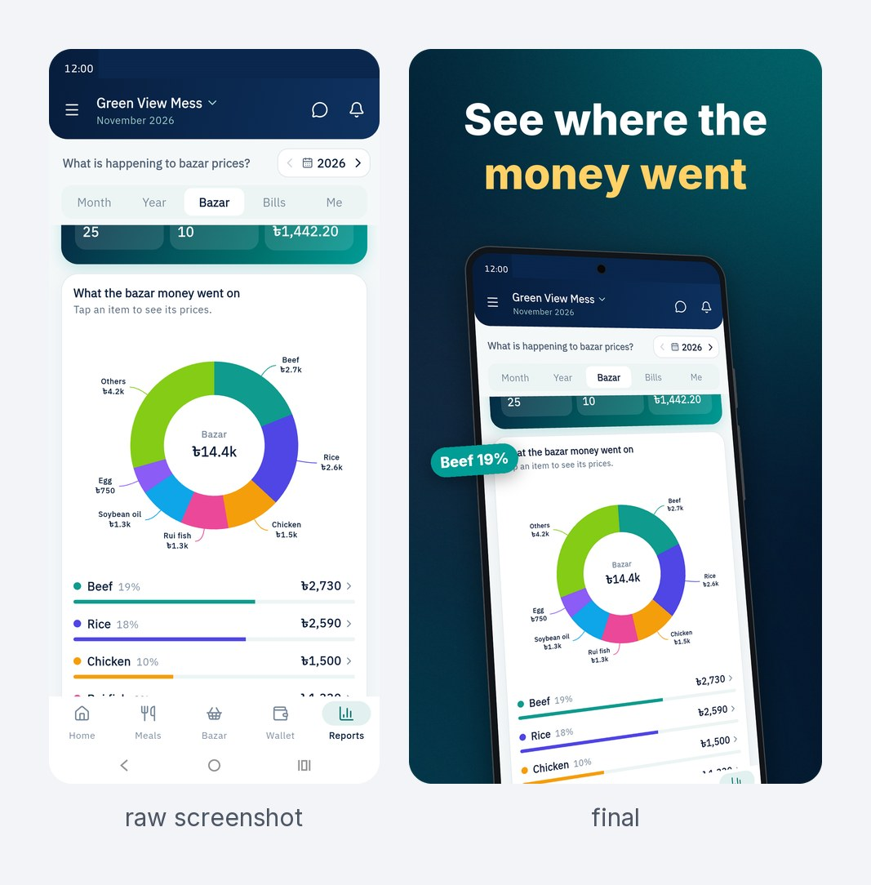

**One set, three looks:** `mesh`, `light` and `gradient`. The layouts change from screen to screen.

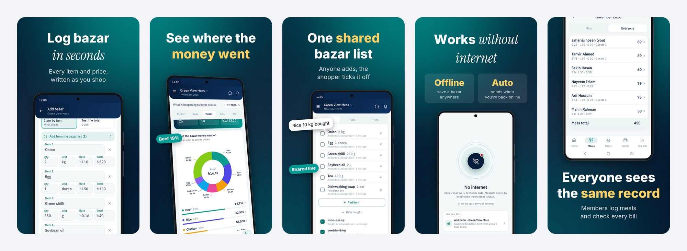
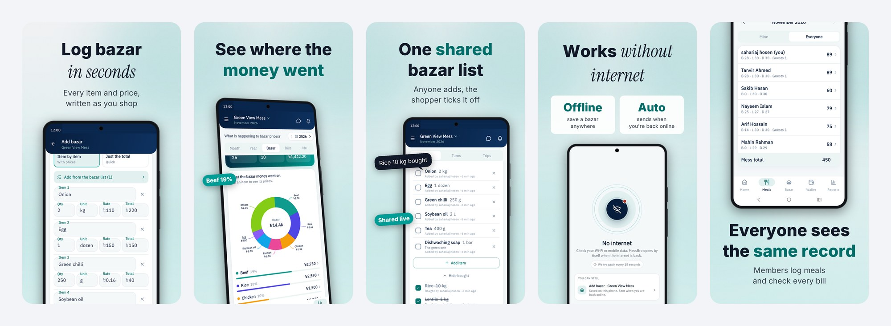
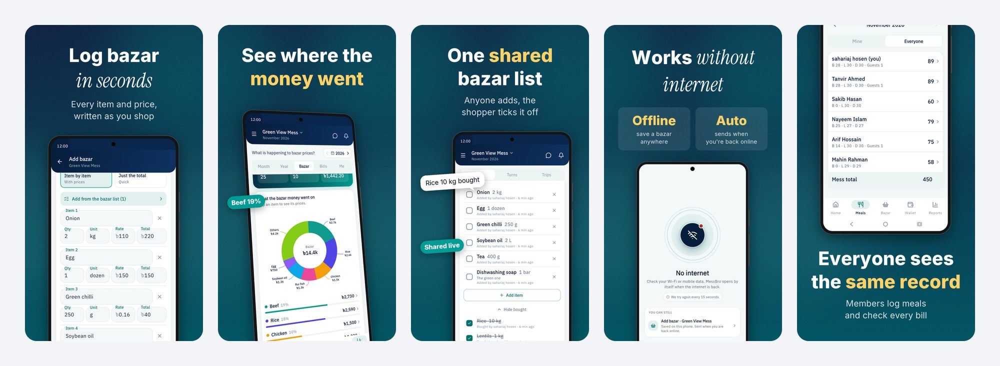

**Panorama.** One background runs across the whole set, so the screenshots join up in the Play
carousel.

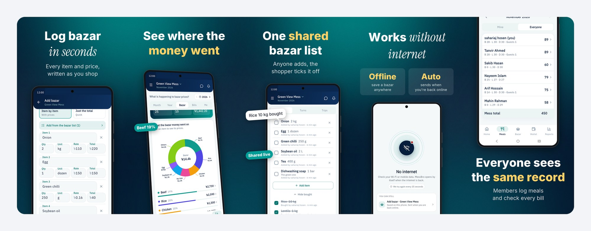

**Five layouts:** `top`, `bottom`, `tilted`, `stats` and `bubble`. Mix them so the set doesn't
look like one slide five times. The stats cards and bubbles use facts from the real screen.

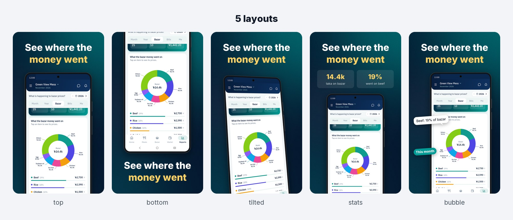

**Five styles:** `flat`, `gradient`, `mesh`, `light` and `popout`.

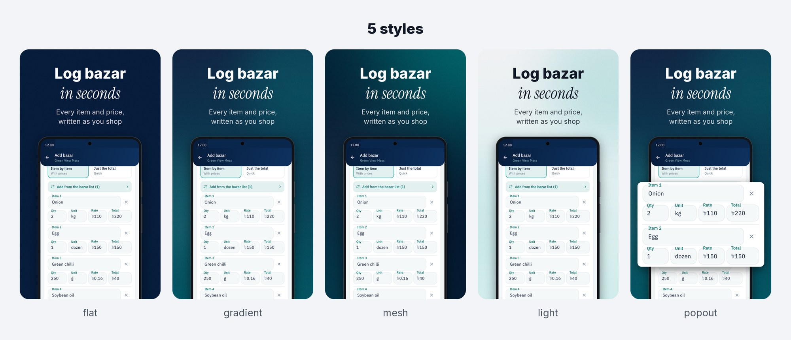

**Two-colour headlines.** Mark the key words: `*word*` for the highlight colour, `_word_` for
the accent font.

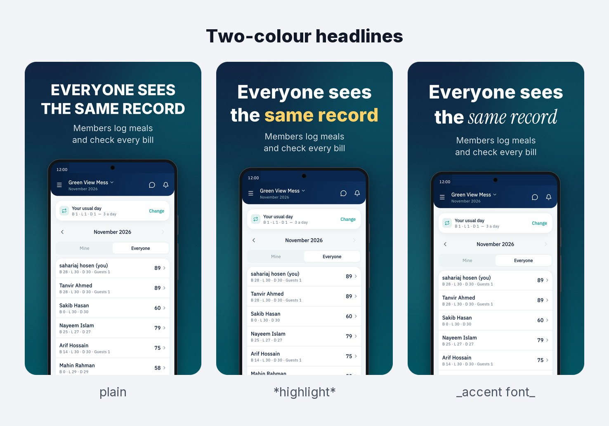

**Highlight colour.** `colors.py` shows your headline in eight colours on your own screenshot,
with contrast and hue gap, and marks its automatic pick.

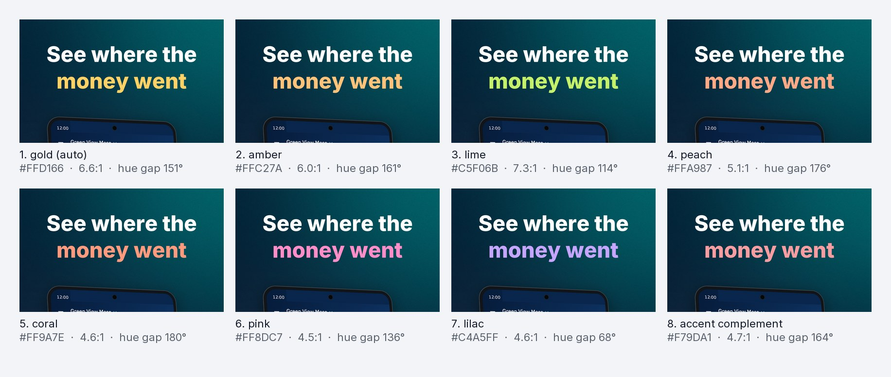

**Font pairs** from `fonts.py`: `clean`, `friendly`, `tech`, `editorial` and `playful`.

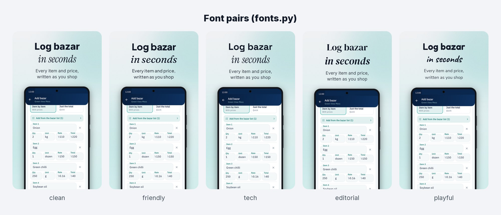

**Feature graphics:** `gradient`, `duo`, `mesh` and `cards` (no device frame), plus the
safe-area guide with the edge cutoff zones and the video play-button area.

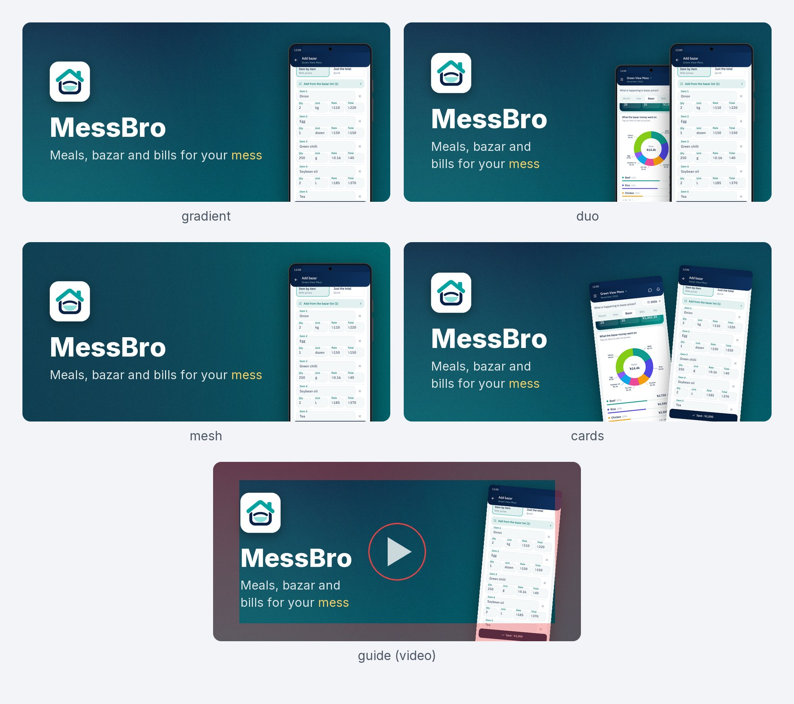

## Description and release notes

| Skill | What it does |
|---|---|
| **playstore-description** (`description/`) | Writes the listing text for Play search (ASO): app title (30), short description (80) and full description (4,000). It uses keyword research, a keyword map (one main phrase in the title, short description and first line; 5–8 supporting phrases used naturally) and the "only here" line. `listing_check.py` checks the length limits, banned words, emoji, caps, keyword lists, repeated short description, competitor names, and where each keyword lands. It also gives a checklist for the rest of the listing: category, tags, contact, privacy policy, Data safety, content rating, translations and experiments. The keyword method is adapted from web-SEO practice such as [claude-seo](https://github.com/AgriciDaniel/claude-seo). |
| **playstore-release-notes** (`release-notes/`) | Writes the "What's new" text for each update from your git history since the last release. It keeps only changes users notice, in plain words, in Play's `<en-US> … </en-US>` format, with a 500-character limit per language. `release_notes.py collect` gathers the commits, `check` checks the tags and the length, and `mark` remembers the release for next time. |

## Why not just reuse App Store screenshots?

| | App Store | Google Play |
|---|---|---|
| Size | 1290×2796 (6.7") | **1080×1920** (9:16). Play allows a long side up to 2.3× the short side, but its recommendation spots need **9:16** (or 16:9) at 1080 px or more. |
| Count | up to 10 | **2–8** per device type. You need **4+** for the recommendation spots. |
| Extra | — | **Feature graphic 1024×500**, required to publish. Tablet and Chromebook sets (1,080–7,680 px). |
| Transparency | — | **not allowed** |
| Text | — | Taglines under 20% of the image. No ranking, award, rating or testimonial claims, no price or promo words, no calls to action |
| Phone frame | iPhone | Android (or no frame) |

## Install

**Claude Code**
```bash
git clone https://github.com/sahariajf/claude-skill-playstore-listing ~/claude-skill-playstore-listing
ln -s ~/claude-skill-playstore-listing ~/.claude/skills/playstore-screenshots
ln -s ~/claude-skill-playstore-listing/description ~/.claude/skills/playstore-description
ln -s ~/claude-skill-playstore-listing/release-notes ~/.claude/skills/playstore-release-notes
pip install Pillow
```
On Windows (PowerShell), make the links with `New-Item -ItemType Junction -Path <link> -Target <folder>`.
A `git pull` in the clone then updates all three skills.

Then, in your app's project, ask for what you need:
- *"make Play Store screenshots for this app"*
- *"write the Play Store description"*
- *"write release notes for this update"*

**Other agents** (Codex, Gemini CLI, Cursor and others that support `SKILL.md` skills):
clone the repo into that agent's skills folder. You can also point the agent at `SKILL.md`.

**Optional:** install [Android platform-tools](https://developer.android.com/tools/releases/platform-tools)
(`adb`) if you want to take screenshots straight from a phone or emulator.

## Scripts

You can also run the scripts by hand:

| Script | What it does |
|---|---|
| `description/scripts/listing_check.py` | Checks listing text (limits, policy words, keyword placement). |
| `release-notes/scripts/release_notes.py` | `collect` commits since the last release, `check` the notes, `mark` a release. |
| `scripts/compose.py` | Makes a screenshot: headline + real screen in an Android phone or tablet frame, in 5 styles and 5 layouts. `--device` (tablet7, tablet10, chromebook) and `--locale` select the set. `--pick` copies the one you choose to `final/`. |
| `scripts/backgrounds.py` | The backgrounds: flat, gradient, mesh, light, grain, dots/grid, panorama. |
| `scripts/feature_graphic.py` | Makes the 1024×500 feature graphic in 6 styles, with a safe-area guide image. |
| `scripts/fonts.py` | Lists curated Google Fonts pairs and downloads one into your project. |
| `scripts/colors.py` | Picks the highlight colour for marked words and renders the options on your real screenshot to choose from. |
| `scripts/prompts.py` | Writes a short image-AI prompt for each screen and the feature graphic, with a folder of the files to attach (per language and device too). |
| `scripts/polish.py` | Puts the real phone layer back on top of an AI-polished image. |
| `scripts/capture.py` | adb helper: `devices`, `demo on/off`, `foreground`, `shot`. |
| `scripts/check.py` | Checks Play's rules for every set in `final/` (phone, tablets, languages) and all the texts. |
| `scripts/showcase.py` | Makes one preview image of the whole set. |
| `scripts/android_frame.py` | Draws the plain Android phone or tablet frame. |

Each script prints its usage with `--help`. To start your own settings file, copy
`example.playstore.json` to `store-screenshots/playstore.json` in your project.

```bash
python scripts/compose.py --screenshot home.png --headline "Split *bazar costs*" \
  --sub "Everyone pays their fair share" --bg "#071D3C" --accent "#009C96" \
  --style mesh --layout tilted --grain 0.3 --out out.png
```

## Fonts

The skill doesn't come with any fonts. Point `fonts.bold` / `fonts.regular` (and `fonts.accent`
for `_marked_` words) in `playstore.json` at your app's font files. Variable fonts work:
`"IBMPlexSans[wdth,wght].ttf#Bold"`. Or let `fonts.py` download a curated Google Fonts pair:

```bash
python scripts/fonts.py list
python scripts/fonts.py get clean --config store-screenshots/playstore.json
```

If no font is set, it uses a system font such as Segoe UI, Arial or DejaVu Sans.

## Credits

The idea and workflow come from
[adamlyttleapps/claude-skill-aso-appstore-screenshots](https://github.com/adamlyttleapps/claude-skill-aso-appstore-screenshots)
(MIT), which does the same for the iPhone App Store on macOS. This repo is a new implementation
for Google Play, and it is cross-platform.

## License

MIT
