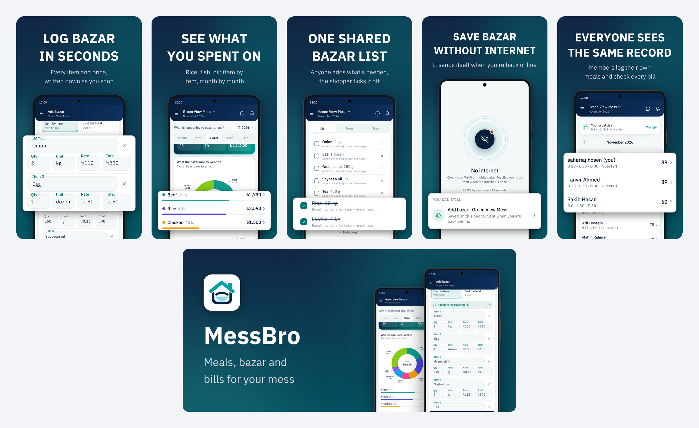
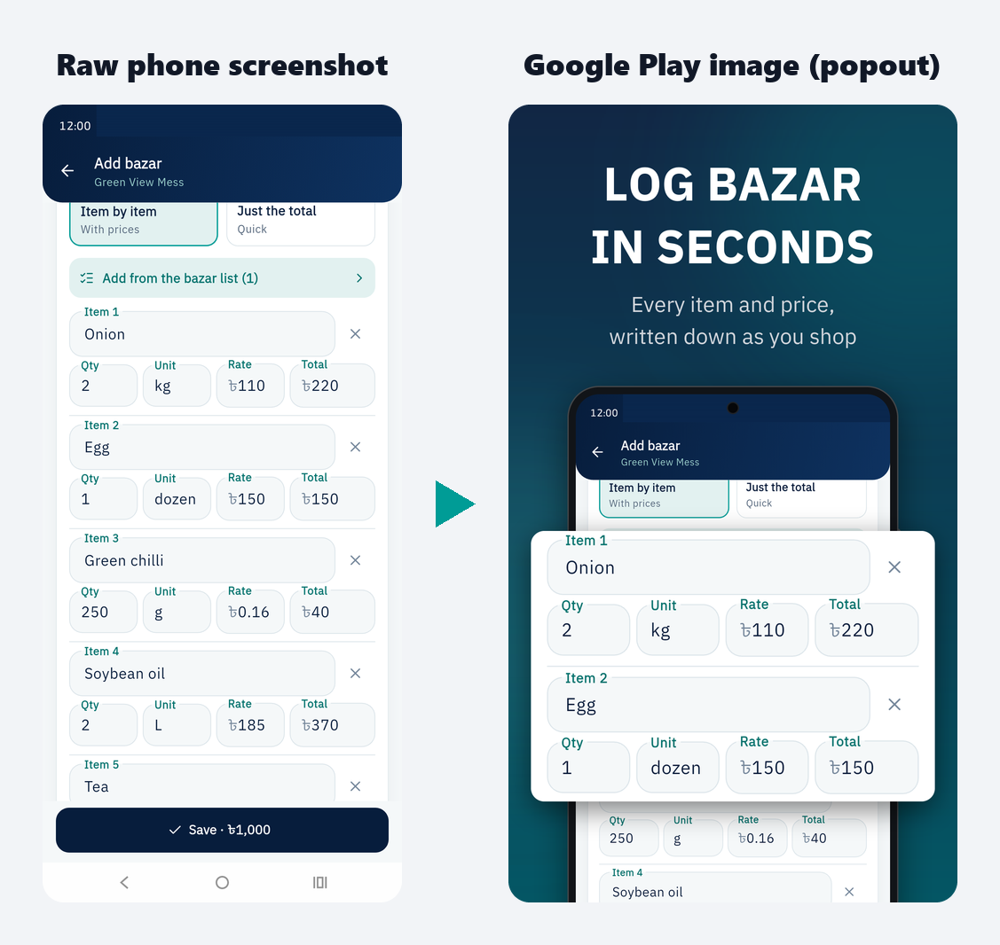

# Google Play listing skills

Three agent skills for an Android app's **Google Play listing**:

| Skill | Makes |
|---|---|
| **playstore-screenshots** | Phone screenshots and the feature graphic, from your app's real screens |
| **playstore-description** | App title, short and full description, written for Play search (ASO), plus the listing checklist |
| **playstore-release-notes** | The "What's new" text for each update, from your git history |

They work with Claude Code and other agents that read `SKILL.md` skills. They run on
Windows, macOS and Linux. The only thing they need is Python, plus Pillow for the screenshots.



*A real run on [MessBro](https://messbro.vercel.app), a mess-management app. The screens use demo data
that the skill suggested and added to a separate demo mess.*



## Screenshots: what it does

1. **Finds your app's benefits.** It reads your code and writes 4–8 short headlines
   ("SPLIT BAZAR COSTS", not "EXPENSE MODULE"). You approve them.
2. **Suggests demo data.** Empty screens look bad, so it suggests realistic data for each screen.
   If you say yes, it adds that data to a separate demo account, and it notes how to remove it later.
3. **Gets clean screenshots**, in one of two ways:
   - **From your phone or emulator (adb):** it turns on demo mode for a clean status bar and only
     takes a shot when your app is in front. It never taps on your phone.
   - **From a folder:** you add the screenshots yourself.

   Either way, it rates each shot Great, Usable or Retake.
4. **Builds 3 versions** of each screenshot, and you pick one:
   - **flat:** a solid brand colour behind a plain Android phone (camera hole, no iPhone notch).
   - **gradient:** brand colour fading into the accent colour.
   - **popout:** one card from your real screen, made bigger and lifted out of the phone.
5. **AI polish, if your agent has an image tool** (for example a Gemini "Nano Banana" MCP or
   OpenAI images). Afterwards the real app screen is **pasted back on top**, so the AI can't
   change your UI.
6. **Writes prompts for any image AI.** You get a short, ready-to-paste prompt for each screen and
   for the feature graphic, plus a folder with the files to attach (layout, real screen, logo).
   They work in ChatGPT, Gemini, Midjourney, Canva or any other image tool. There are two prompts
   per screen:
   - **Layout locked:** the real screen can be pasted back on top afterwards.
   - **Free design:** more creative, but you have to check the screen by eye.
7. **Makes the feature graphic** (1024×500) in 3 styles.
8. **Checks everything** against Play's rules (sizes, transparency, 2:1 limit, banned words like
   "#1", "best", "free", "download now"), then makes a preview of the whole set.

## Description and release notes

| Skill | What it does |
|---|---|
| **playstore-description** (`description/`) | Writes the listing text for Play search (ASO): app title (30), short description (80) and full description (4,000). It uses keyword research, a keyword map (one main phrase in the title, short description and first line; 5–8 supporting phrases used naturally) and the "only here" line. `listing_check.py` checks the length limits, banned words, emoji, caps, keyword lists, repeated short description, competitor names, and where each keyword lands. It also gives a checklist for the rest of the listing: category, tags, contact, privacy policy, Data safety, content rating, translations and experiments. The keyword method is adapted from web-SEO practice such as [claude-seo](https://github.com/AgriciDaniel/claude-seo). |
| **playstore-release-notes** (`release-notes/`) | Writes the "What's new" text for each update from your git history since the last release. It keeps only changes users notice, in plain words, in Play's `<en-US> … </en-US>` format, with a 500-character limit per language. `release_notes.py collect` gathers the commits, `check` checks the tags and the length, and `mark` remembers the release for next time. |

## Why not just reuse App Store screenshots?

| | App Store | Google Play |
|---|---|---|
| Size | 1290×2796 (6.7") | **1080×1920** (9:16). The long side can be at most 2× the short side, so 1290×2796 is **rejected**. |
| Count | up to 10 | **2–8**. 4+ at ≥1080 px is reportedly needed for Play's big recommendation spots. |
| Extra | — | **Feature graphic 1024×500**, required to publish |
| Transparency | — | **not allowed** |
| Text | — | No ranking or award claims, no price or promo words, no calls to action |
| Phone frame | iPhone | Android (or no frame) |

## Install

**Claude Code**
```bash
git clone https://github.com/sahariajf/claude-skill-playstore-listing ~/claude-skill-playstore-listing
ln -s ~/claude-skill-playstore-listing ~/.claude/skills/playstore-screenshots
ln -s ~/claude-skill-playstore-listing/description ~/.claude/skills/playstore-description
ln -s ~/claude-skill-playstore-listing/release-notes ~/.claude/skills/playstore-release-notes
pip install Pillow
```
On Windows (PowerShell), make the links with `New-Item -ItemType Junction -Path <link> -Target <folder>`.
A `git pull` in the clone then updates all three skills.

Then, in your app's project, ask for what you need:
- *"make Play Store screenshots for this app"*
- *"write the Play Store description"*
- *"write release notes for this update"*

**Other agents** (Codex, Gemini CLI, Cursor and others that support `SKILL.md` skills):
clone the repo into that agent's skills folder. You can also point the agent at `SKILL.md`.

**Optional:** install [Android platform-tools](https://developer.android.com/tools/releases/platform-tools)
(`adb`) if you want to take screenshots straight from a phone or emulator.

## Scripts

You can also run the scripts by hand:

| Script | What it does |
|---|---|
| `description/scripts/listing_check.py` | Checks listing text (limits, policy words, keyword placement). |
| `release-notes/scripts/release_notes.py` | `collect` commits since the last release, `check` the notes, `mark` a release. |
| `scripts/compose.py` | Makes a phone screenshot: headline + real screen in an Android frame, in 3 styles. `--pick` copies the one you choose to `final/`. |
| `scripts/feature_graphic.py` | Makes the 1024×500 feature graphic in 3 styles. |
| `scripts/prompts.py` | Writes a short image-AI prompt for each screen and the feature graphic, with a folder of the files to attach. |
| `scripts/polish.py` | Puts the real phone layer back on top of an AI-polished image. |
| `scripts/capture.py` | adb helper: `devices`, `demo on/off`, `foreground`, `shot`. |
| `scripts/check.py` | Checks Play's rules for the images and the headline text. |
| `scripts/showcase.py` | Makes one preview image of the whole set. |
| `scripts/android_frame.py` | Draws the plain Android phone frame. |

Each script prints its usage with `--help`. To start your own settings file, copy
`example.playstore.json` to `store-screenshots/playstore.json` in your project.

```bash
python scripts/compose.py --screenshot home.png --headline "Split bazar costs" \
  --sub "Everyone pays their fair share" --bg "#071D3C" --accent "#009C96" \
  --style gradient --out out.png
```

## Fonts

The skill doesn't come with any fonts. Point `fonts.bold` / `fonts.regular` in `playstore.json`
at your app's font file. Variable fonts work: `"IBMPlexSans[wdth,wght].ttf#Bold"`. If no font is
set, it uses a system font such as Segoe UI, Arial or DejaVu Sans.

## Credits

The idea and workflow come from
[adamlyttleapps/claude-skill-aso-appstore-screenshots](https://github.com/adamlyttleapps/claude-skill-aso-appstore-screenshots)
(MIT), which does the same for the iPhone App Store on macOS. This repo is a new implementation
for Google Play, and it is cross-platform.

## License

MIT
